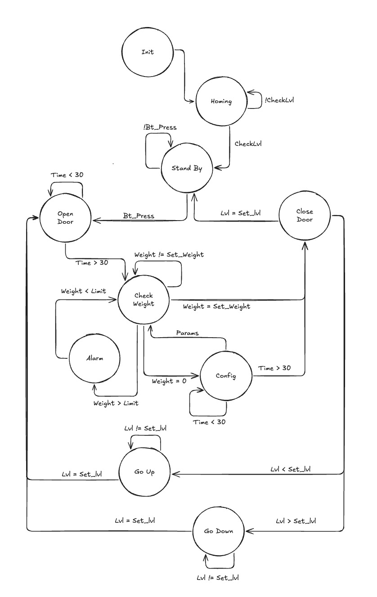

# TP_INT_INFO_2

Realizado por Lara Diaz Steinbrecher 

## Ascensor de carga

El proyecto será desarrollado en lenguaje C, utilizando una Raspberry Pi Pico, para el control de un ascensor de carga con un sistema de regulación de peso.
Al iniciar el programa, el ascensor realizará una primera etapa de homing, durante la cual se posicionará en el piso 0 o inicial. Una vez finalizada esta etapa, pasará al modo de espera.
Cuando el usuario presione el botón de activación, se encenderá la pantalla y se habilitará el modo de configuración, en el que podrá seleccionar el piso de destino e ingresar el peso esperado de la carga. A continuación, el sistema medirá el peso del paquete y lo comparará con el valor ingresado. Si el peso supera el límite establecido, se activará una alarma para indicar que se debe retirar el excedente. Una vez alcanzado el peso indicado, las puertas se cerrarán y el ascensor iniciará el desplazamiento hacia el piso seleccionado.
Al llegar a destino, las puertas se abrirán y el sistema continuará monitoreando el peso de la carga. Cuando el usuario retire el paquete y la balanza registre un peso de cero, se habilitará nuevamente el modo de configuración para permitir un nuevo ciclo de funcionamiento. Si no se ingresan nuevos parámetros, las puertas se cerrarán y el ascensor regresará al modo de espera.

### Componentes

- Raspberry Pi Pico
- Celda de carga de 1kg
- Modulo Amplificador HX711
- Display OLED Blanco 0.96 Interfaz I2C
- Buzzer activo
- Motor reductor micro pololu DC
- Boton

## Diagrama de Maquina de Estado

